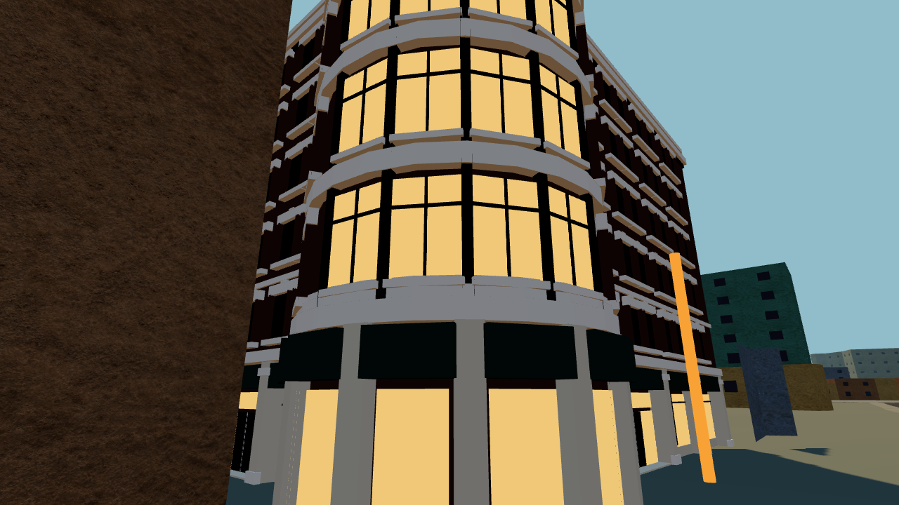
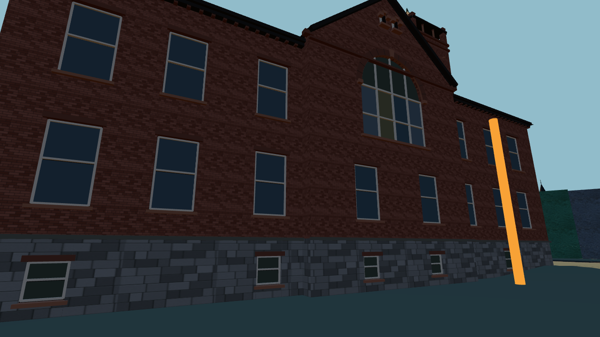
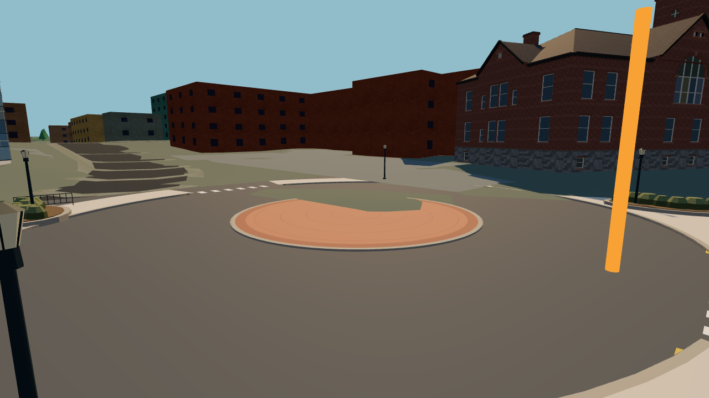
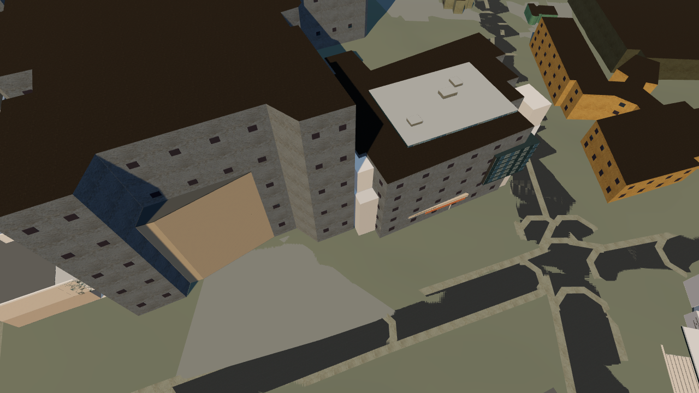
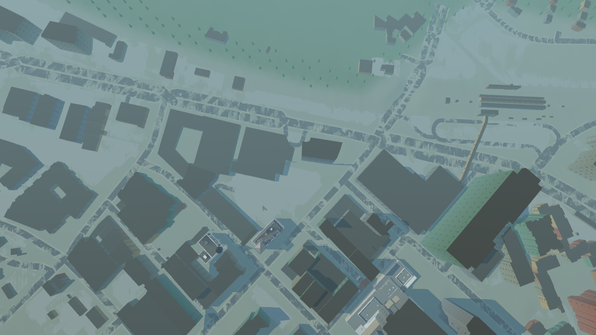

# City development foundation

This branch starts from `grok/city-geometry-upgrade` (PR #4). It does not merge into `main`, and it does not merge PR #4. The geographic audit from PR #3 is already on that branch under `docs/geographic-audit/`; nothing further had to be cherry-picked.

The game still loads Three.js r187 from the CDN. Axes are unchanged: +X east, +Y up, −Z north, 1 unit = 1 metre. Measured terrain, footprint rings, and the height table are the same files as PR #4. Heights still run from 0.95 m to 73.65 m. High 137, Medium 132, Estimated 243.

## Playable boundary

The outline the game uses is `public/data/playable-boundary.geojson`. It is the audit polygon: west −77.155, north at gLeaf (808 Hungerford), east along the rail and around the Metro station including the rear lot, south keeping 700 Rockville Pike and 208 Monroe Street and leaving Richard Montgomery High School outside. `src/main.js` used to read the copy under `docs/geographic-audit/`. It now reads the game file.

## Defect fixes

### Windows and entrances

Openings are cut into the wall instead of sitting 11 cm proud of it. Each opening is kept inside the visible wall and at least 0.45 m above the terrain sample at that column, so a ground-floor window no longer starts in the hillside. Where two footprints share a wall, the upper wall still begins at the lower roof, and the openings begin there too, so they do not hang in the gap. Upper masses (the DHHS tower on 401 Hungerford) overlap the parent roof by 8 cm instead of floating 5 cm above it. Wall bases follow the terrain along the footprint, about every 8 m, so a downhill face meets the ground and an uphill face is not a buried plinth with openings in it.

Headless result: 5,817 openings placed, 0 buried, 0 rejected for leaving the wall. The previous build placed 9,303. The drop is the openings that used to start below grade or below a neighbour roof.

### Roads through footprints

Carriageway and sidewalk ribbons stop at a footprint instead of drawing through it. On the integrated run, 91 ribbon pieces were narrowed and 13 were omitted.

The 14 samples that ran through 34 Maryland Avenue were one east-west centreline chord in `src/config.js` (from −77.15096, 39.086192 to −77.150632, 39.086193). That chord crossed footprint 153949. The north-south Maryland Avenue centreline on the west side of the block was already clear, so the chord was removed and the spur now starts on the clear east side of the block. The building was not cut open and no height changed.

After that edit the walk is 7,816 centreline samples. None are interior to a building with no way around. 19 samples still touch a footprint: 15 have a clear shoulder within 6 m and 4 have a detour within 16 m. Those are 51 Monroe Street (131008) and 111 Rockville Pike (126956), plus body-radius grazes. The downtown controller still walks 32.06 m with no fully blocked step. A one-second nudge through the gameplay loop moved 5.16 m.

Five centreline steps still rise more than 0.45 m. The worst is 0.97 m over 2 m. That is the 10 m DEM on a steep cell, the same figure as PR #4, not a broken road join.

## Districts

Every playable footprint has one district. The 508 audit rows are all owned. Four extra footprints whose centroids also sit inside the polygon are owned as well, so the runtime set of 512 has no leftover.

| Code | District | Playable buildings | Of which are in the 508 |
| --- | --- | --- | --- |
| A | Town Square | 19 | 19 |
| B | Hungerford Corridor | 198 | 197 |
| C | Regal and Courthouse | 31 | 31 |
| D | Rockville Pike and Metro | 264 | 261 |

The four extras are 819 Hungerford Drive (B), and 204 Highland Avenue, 208 Monroe Street's second footprint, and 210 Monroe Street (all D).

Assignment is by address and centroid, then the district polygon is the Voronoi cell of those centroids (plus five open-ground anchors for the plaza, the courthouse lawn, and the Metro platform) clipped to the playable boundary. The four polygons do not overlap. Their union is the playable polygon. Every centroid falls in the polygon for its own district. `scripts/validate_foundation.py` checks that.

Town Square is the plaza cluster: Helen Heneghan Way, the Cambria at 196 East Montgomery, the 198 East Montgomery podiums, and the East Middle Lane row. Regal, the colonnade footprint at 199 East Montgomery, Maryland Avenue, Courthouse Square, the red-brick courthouse, the grey courthouse, Circuit Court, District Court, City Hall, and the Executive Office Building are C. Hungerford Drive's northern commercial stretch, both sides, inside the boundary, including 808 Hungerford, is B. Everything else inside the line, including the Metro station, the Pike, and 1 Church Street, is D.

Map: [maps/district-ownership.png](maps/district-ownership.png)

Boundaries: `public/data/districts/boundaries.geojson` (WGS84 and game metres on each ring).

Ownership: `public/data/ownership.json` and [data/building-ownership.csv](data/building-ownership.csv).

## Landmark files

Every GLB under `public/landmarks/` matches its source commit byte for byte. Nothing was rebuilt, simplified, or re-exported. SHA-256 of the working tree equals SHA-256 of `git show <commit>:<path>`.

| File | SHA-256 | Source | Match |
| --- | --- | --- | --- |
| `clock_tower_building.glb` | `0fcfd6003b213f407e277c7b091877e69cd0353bbb439e562a0bf044e4908020` | `grok/rockville-landmarks` `30ed3aa` (PR #2) | yes |
| `turret_corner_building.glb` | `73abdb84332587571b5349f288751af1cb4bf413fcdbce9caca76f6f1698d792` | same commit | yes |
| `regal.glb` | `0605a64ad922d1691b400be740e81f9fe4fc475d38c7643234bd7b58e8d77332` | PR #9 commit `3975de5` | yes |
| `white-columned.glb` | `804a24684de52e43e6b3b17e8f612b15053ecfd984ce0fae1d45eb4c643e2ac8` | `3975de5` | yes |
| `courthouse.glb` | `5ac46f92e620d062dee9e991d993e8067c5341ff854ea77026afcb2b50125f67` | `3975de5` | yes |
| `district-court.glb` | `8459933131f653003e10f4e9b31deb026d5463c1782ae940f3513f871582f812` | `3975de5` | yes |
| `roundabout-plaza.glb` | `0e24560d2c42684df23dffd945709322fbf99cd00bc166bd625035a484bc3587` | `3975de5` | yes |
| `historic_courthouse.glb` | `6f37f742aaec3bb2d1c3a96f585813ad253b0c4ab7a7f4530cbbebd71708d1f5` | `landmark/historic-courthouse` `c34966f`, and the same bytes in `3975de5` | yes |
| `regal-cinemas.glb` | `6b088300056ffb223e9cb6d6cad9e9edba40f5cfce81d9ee0ca1d52e9d232ab7` | PR #1 `369a2db` | yes |
| `montgomery-colonnade.glb` | `444e17ab842e895e0979a85920c8161b65aab78cb21ae60b7e00ff9057c5a252` | PR #1 `369a2db` | yes |

### Regal and the white-columned complex, two versions each

Neither file was deleted or overwritten.

| | PR #1 `regal-cinemas.glb` | PR #9 `regal.glb` | PR #1 `montgomery-colonnade.glb` | PR #9 `white-columned.glb` |
| --- | --- | --- | --- | --- |
| Triangles | 5,820 | 22,254 | 6,452 | 6,518 |
| Materials | 14 flat colours | 23 named finishes | 7 flat colours | 16 named finishes |
| Size X × Z × Y | 30.2 × 25.9 × 28.4 m | 48.1 × 35.1 × 24.2 m | 51.1 × 22.3 × 11.8 m | 55.0 × 24.1 × 15.3 m |
| Origin | ground centre, min Y = 0 | ground centre, min Y = 0 | ground centre, min Y = 0 | ground centre, min Y = 0 |
| Street side | +Z (awnings, marquee) | +Z (marquee and REGAL letters out to z ≈ +19) | +Z | +Z (columns and canvas out to z ≈ +11) |

The scene uses the PR #9 files. The assignment names `regal.glb` and `white-columned.glb`, they are the later owner delivery, and the Regal plan is closer to a real cinema frontage than the 30 m PR #1 block. The PR #1 files stay in `public/landmarks/` and are inactive rows in the District C manifest.

## Placement

All eight are unapproved. An orange pole marks each one. No model was scaled. Units are metres: every file has min Y = 0 and a plan measured in tens of metres, so a feet-to-metres scale was not applied. District ownership was not edited. 1 Church Street (129521) is a normal procedural building again.

| Landmark | Footprint removed | Address | Model X × Z × height | County box | Origin vs footprint centre | Rotation |
| --- | --- | --- | --- | --- | --- | --- |
| Clock tower | 131322 | 200 E Middle Lane | 42.8 × 20.2 × 41.8 m | 62.3 × 24.9 m, height record 24.2 m | 0 m (origin is the model centre) | 0. Facade (+Z) faces south onto the open frontage. Tower at the west end. |
| Turret | 227492 | 33 Maryland Ave, next north of the Starbucks block at 39 Maryland Ave (127071) | 31.5 × 30.5 × 45.1 m | 25.4 × 37.4 m, height record 24.2 m | 0 m | π/2, rounded corner toward the Starbucks corner. The generic π suggestion pointed the corner northeast and was not used. |
| Regal | 277318, shared | 199 E Montgomery Ave, east half | 48.1 × 35.1 × 24.2 m | whole footprint 140.6 × 28.0 m, height record 15.1 m | model centre on the east half | 0, marquee south |
| White-columned | same 277318 | 199 E Montgomery Ave, west half | 55.0 × 24.1 × 15.3 m | same footprint | model centre on the west half | 0, columns south |
| Circuit Court | 129186 | 50 Maryland Ave | 91.7 × 134.6 × 34.1 m | 90.0 × 133.7 m, north tower record 46.0 m | about 1 m (model bbox centre is 1.1 m east and 2.7 m south of the origin) | 0. The materials named North sit on model −Z, which is world north. |
| District Court | 132710 | 191 E Jefferson St | 94.4 × 84.8 × 24.0 m | 92.3 × 83.4 m, height record 36.8 m | about 1 m | 0, axes match the footprint |
| Historic courthouse | 129058 | 29 Courthouse Sq | 23.9 × 38.5 × 30.2 m | 30.9 × 37.3 m, height record 12.8 m | origin on the footprint centre; the bbox centre is 1.2 m west and 2.5 m north of the origin | −26°, so the −Z entry faces 26° east of north, the footprint's long-axis bearing |
| Roundabout plaza | none | open ground south of 29 Courthouse Sq | 41.6 × 46.2 × 4.2 m | no building | placed on open ground | 0. No collider, so the square stays walkable |

The two Montgomery models together are 103 m along a 141 m frontage, so about 19 m of that footprint at each end has no mesh after the procedural mass is removed. The footprint collider still covers the whole county polygon. Regal's marquee bbox is about 7 m deeper than the 28 m footprint.

## Landmark inventory

No owner approval is recorded for any model. The clock-tower rebuild that was requested was stopped. The historic-courthouse specification says awaiting approval. `grok/hungerford-corridor` was not on the remote.

A manifest row with `glb: null` (`missing-model-fallback`) is the empty-file test. The loader reports `fallback: procedural` and does not remove a building. 1 Church Street (129521) is no longer a landmark target.

## Parallel structure

`public/data/modules.json` names the six slots. `src/runtime/modules.js` imports each `module.js` and, only when that owner's `module.json` sets `extension`, imports the extension. Landmark manifests are loaded from the same index. Details, the `register(ctx)` contract, and the Hungerford rebase steps are in [CONTRIBUTING.md](CONTRIBUTING.md).

## Validation

`python3 scripts/validate_foundation.py` reports no problems. Headless Chrome, SwiftShader, 1280×720, the same flags as PR #4.

| Check | Result |
| --- | --- |
| Audit buildings with one owner | 508 / 508 |
| Playable buildings with one owner | 512 / 512 |
| District polygon overlap | none |
| Union of districts vs playable polygon | the same polygon |
| Buried openings | 0 |
| Openings rejected for leaving the wall | 0 |
| Road pieces trimmed or omitted at footprints | 91 trimmed, 13 omitted |
| Centreline samples with no way around a building | 0 (was 14, through 34 Maryland Avenue) |
| Centreline samples that still touch a footprint | 19, each with a shoulder within 6 m (15) or a detour within 16 m (4) |
| Placeholders removed | 131322, 227492, 277318, 129186, 132710, 129058 |
| Roundabout | placed, no placeholder, no collider |
| Missing model | procedural fallback, no building removed |
| Console errors | none |
| Controller | 32.06 m, 0 blocked steps |
| Gameplay nudge | 5.16 m |

There is no zombie actor on `main` or on this branch. The loop that runs is the existing first-person loop: walk, sprint, aim, and render. That loop advanced, and the nudge above is a one-second walk through it.

### Performance

Same machine, same SwiftShader, before any of these edits and after them. The published PR #4 numbers are in the third column. This machine's before-shot did not reproduce 16 draw calls; the triangle count did match, so the scene is the same and the draw-call counter here includes the shadow pass and the individual street lights.

Renderer: ANGLE SwiftShader (Subzero), Vulkan 1.3.0, on this VM's Intel Xeon. 1280×720. The published 16 draw calls were not reproduced on this machine; the before triangle count matches PR #4, and the counter here includes the shadow pass and the individual street lights.

| | This machine, before any of this work | After geometry fixes, clock tower only | After all eight landmarks | Published PR #4 |
| --- | --- | --- | --- | --- |
| Draw calls | 47 | 58 | 122 | 16 |
| Triangles | 334,823 | 276,028 | 337,915 | 334,261 |
| Frame time | 417 ms | 362 ms | 414 ms | 285 ms |

Window instances fell from 9,303 to 5,817, which is why the middle column is faster. Placing the eight GLBs puts the frame time back near the original software-GL number. The extra draw calls are the models' materials (one primitive each) and the orange markers. None of the GLBs were merged or re-exported to reduce that.

## Screenshots

Street views use the same stands as PR #4. Before frames are the branch before these edits. After frames are this branch.

| View | Before | After |
| --- | --- | --- |
| Overview | [before](screenshots/before/overview.png) | [after](screenshots/after/overview.png) |
| Town Square | [before](screenshots/before/town-square.png) | [after](screenshots/after/town-square.png) |
| Hungerford | [before](screenshots/before/hungerford.png) | [after](screenshots/after/hungerford.png) |
| Maryland and Regal | [before](screenshots/before/maryland-regal.png) | [after](screenshots/after/maryland-regal.png) |
| Courthouse Square | [before](screenshots/before/courthouse-square.png) | [after](screenshots/after/courthouse-square.png) |
| Rockville Pike | [before](screenshots/before/rockville-pike.png) | [after](screenshots/after/rockville-pike.png) |
| Metro | [before](screenshots/before/metro.png) | [after](screenshots/after/metro.png) |

District stands and the placement tests are after only:

| View | File |
| --- | --- |
| District A | [screenshots/after/district-a.png](screenshots/after/district-a.png) |
| District B | [screenshots/after/district-b.png](screenshots/after/district-b.png) |
| District C | [screenshots/after/district-c.png](screenshots/after/district-c.png) |
| District D, Metro | [screenshots/after/district-d-metro.png](screenshots/after/district-d-metro.png) |
| Clock tower placement | [screenshots/after/clock-tower.png](screenshots/after/clock-tower.png) |
| Entrance at grade | [screenshots/after/entrance-grade.png](screenshots/after/entrance-grade.png) |

## Known limitations

- 239 of the 508 audit heights are still estimates. This pass did not resurvey them.
- Gable ridges are still the 2 m placeholder.
- No landmark is owner-approved. The orange poles are status markers.
- The clock tower is on 200 East Middle Lane (131322), not on a footprint labelled as a clock tower. The county plan is 62 m by 25 m and the model is 43 m by 20 m, so about 10 m at each end of the footprint has collision and no mesh. The measured roof is 24.2 m and the model spire is 41.8 m. District of that building stays D.
- The turret is 33 Maryland Avenue, the next building north of the Starbucks block, not a separate corner footprint at the Starbucks door. The model overhangs that footprint by about 3 m on the short side. 1 Helen Heneghan Way was not used. District stays C.
- Regal and the white-columned model cover 103 m of the 141 m 199 East Montgomery footprint. The shared collider still fills the county polygon. Regal's marquee sticks past the 28 m depth.
- Circuit Court model height is 34.1 m; the measured north tower is 46.0 m. District Court model height is 24.0 m; the measured mass is 36.8 m. Neither was scaled.
- The historic courthouse model is 23.9 m by 38.5 m against a county box of 30.9 m by 37.3 m. Its height record is 12.8 m and the model finial is 30.2 m.
- The roundabout has no collider. Lamps can be walked through. There is still no OSM `junction=roundabout`.
- 19 centreline samples still touch a footprint, with a shoulder or a short detour. Five DEM steps over 0.45 m are unchanged (worst 0.97 m in 2 m).
- The pedestrian bridge deck elevation, clearance, and width are still null.
- District polygons follow centroids. They are ownership areas, not surveyed neighbourhood lines.
- No zombie actors exist in this repository. The verified loop is movement, aim, sprint, and render.
- `grok/hungerford-corridor` did not exist yet. The District B paths are reserved for it. See CONTRIBUTING.md.
- The close Circuit Court frame is inside the 135 m mass. The elevated courthouse frame and the roundabout frame show that group from outside.
