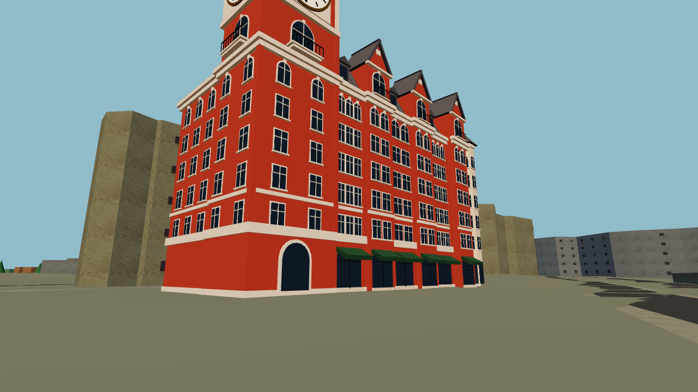
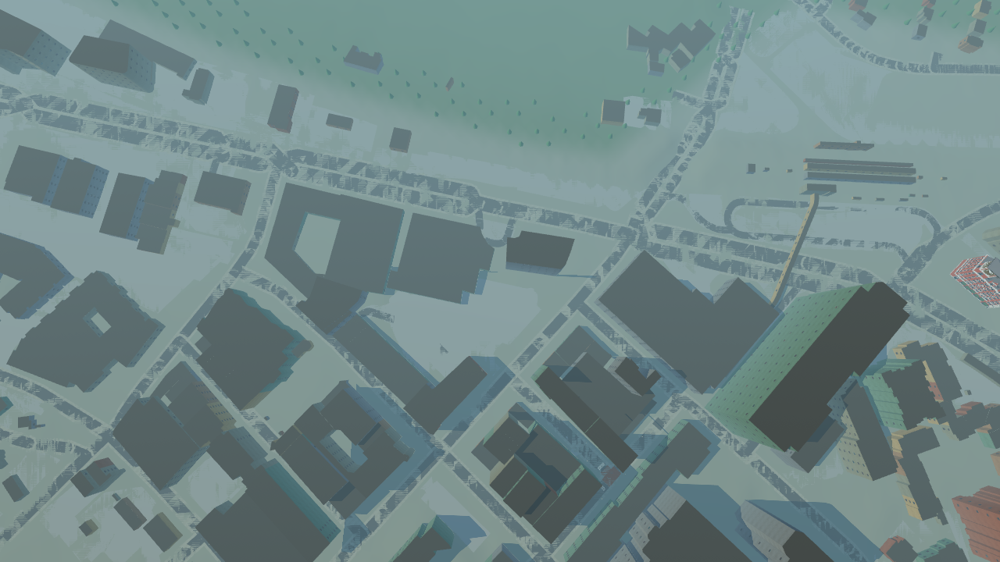
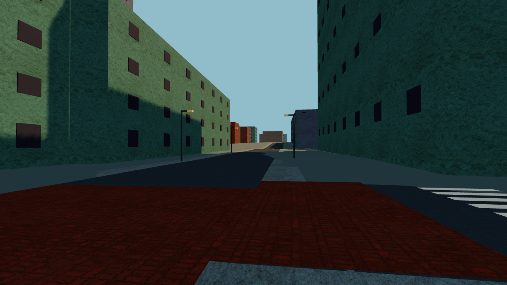

# City development foundation

This branch starts from `grok/city-geometry-upgrade` (PR #4). It does not merge into `main`, and it does not merge PR #4. The geographic audit from PR #3 is already on that branch under `docs/geographic-audit/`; nothing further had to be cherry-picked.

The game still loads Three.js r187 from the CDN. Axes are unchanged: +X east, +Y up, −Z north, 1 unit = 1 metre. Measured terrain, footprint rings, and the height table are the same files as PR #4. Heights still run from 0.95 m to 73.65 m. High 137, Medium 132, Estimated 243.

## Playable boundary

The outline the game uses is `public/data/playable-boundary.geojson`. It is the audit polygon: west −77.155, north at gLeaf (808 Hungerford), east along the rail and around the Metro station including the rear lot, south keeping 700 Rockville Pike and 208 Monroe Street and leaving Richard Montgomery High School outside. `src/main.js` used to read the copy under `docs/geographic-audit/`. It now reads the game file.

## Defect fixes

### Windows and entrances

Openings are cut into the wall instead of sitting 11 cm proud of it. Each opening is kept inside the visible wall and at least 0.45 m above the terrain sample at that column, so a ground-floor window no longer starts in the hillside. Where two footprints share a wall, the upper wall still begins at the lower roof, and the openings begin there too, so they do not hang in the gap. Upper masses (the DHHS tower on 401 Hungerford) overlap the parent roof by 8 cm instead of floating 5 cm above it. Wall bases follow the terrain along the footprint, about every 8 m, so a downhill face meets the ground and an uphill face is not a buried plinth with openings in it.

Headless result: 5,817 openings placed, 0 buried, 0 rejected for leaving the wall. The previous build placed 9,303. The drop is the openings that used to start below grade or below a neighbour roof.

### Roads through footprints

Carriageway and sidewalk ribbons stop at a footprint instead of drawing through it. On this run, 93 ribbon pieces were narrowed and 16 were omitted because the centreline was inside a building.

The walk still samples 7,833 centreline points inside the polygon. 33 are inside a footprint or within the 0.36 m body radius. That count did not change, because the collider is still the measured footprint. Each of the 33 now has a disposition:

| Samples | What it is | Disposition |
| --- | --- | --- |
| 14 | Centreline through 34 Maryland Avenue, footprint 153949, about 25 m, up to 2.7 m inside the south edge and the rest of the way across a continuous Maryland Avenue block (24, 26, 34, and 36 Maryland) | Road mesh removed. No clear lane within 16 m perpendicular to the centreline, because the block is solid. Pedestrians use the streets around the block. Not a gap in the city. |
| 15 | A clear point within 6 m of the centreline | Shoulder beside the wall. The road ribbon is trimmed to the footprint. |
| 4 | A clear point between 7.5 m and 16 m | Short detour off the centreline, same treatment. |

The 19 samples with a lane are the clips of 51 Monroe Street (131008) and 111 Rockville Pike (126956), plus the body-radius grazes of those two. The downtown controller still walks 32.06 m west with 0 fully blocked steps. A second one-second nudge from the gameplay loop moved 5.16 m.

Five centreline steps still rise more than 0.45 m. The worst is 0.97 m over 2 m. That is the 10 m DEM on a steep cell, the same figure as PR #4, not a broken road join.

## Districts

Every playable footprint has one district. The 508 audit rows are all owned. Four extra footprints whose centroids also sit inside the polygon are owned as well, so the runtime set of 512 has no leftover.

| Code | District | Playable buildings | Of which are in the 508 |
| --- | --- | --- | --- |
| A | Town Square | 19 | 19 |
| B | Hungerford Corridor | 198 | 197 |
| C | Regal and Courthouse | 31 | 31 |
| D | Rockville Pike and Metro | 264 | 261 |

The four extras are 819 Hungerford Drive (B), and 204 Highland Avenue, 208 Monroe Street's second footprint, and 210 Monroe Street (all D).

Assignment is by address and centroid, then the district polygon is the Voronoi cell of those centroids (plus five open-ground anchors for the plaza, the courthouse lawn, and the Metro platform) clipped to the playable boundary. The four polygons do not overlap. Their union is the playable polygon. Every centroid falls in the polygon for its own district. `scripts/validate_foundation.py` checks that.

Town Square is the plaza cluster: Helen Heneghan Way, the Cambria at 196 East Montgomery, the 198 East Montgomery podiums, and the East Middle Lane row. Regal, the colonnade footprint at 199 East Montgomery, Maryland Avenue, Courthouse Square, the red-brick courthouse, the grey courthouse, Circuit Court, District Court, City Hall, and the Executive Office Building are C. Hungerford Drive's northern commercial stretch, both sides, inside the boundary, including 808 Hungerford, is B. Everything else inside the line, including the Metro station, the Pike, and 1 Church Street, is D.

Map: [maps/district-ownership.png](maps/district-ownership.png)

Boundaries: `public/data/districts/boundaries.geojson` (WGS84 and game metres on each ring).

Ownership: `public/data/ownership.json` and [data/building-ownership.csv](data/building-ownership.csv).

## Landmark inventory

Searched branches: `main`, `grok/city-geometry-upgrade`, `grok/geographic-data-audit`, `grok/rockville-landmarks`, `cursor/rockville-landmarks-6f3d`, `landmark/historic-courthouse`. `grok/hungerford-corridor` was not on the remote. No owner approval is recorded for any of these models. The clock-tower rebuild that was requested was stopped. The courthouse specification on its branch is marked awaiting approval.

| Asset | Where it is | Format | Approval | On this branch |
| --- | --- | --- | --- | --- |
| Clock tower | PR #2, `grok/rockville-landmarks`, commit `30ed3aa`, `public/landmarks/clock_tower_building.glb`. 20,730 tris, spire 41.8 m, facade +Z, tower at the −X end. | GLB | Unapproved | Yes. Placed as a test. Replaces footprint 129521. `rotationY` = −π/2. Orange pole beside it. |
| Turret corner | Same branch and commit, `public/landmarks/turret_corner_building.glb`. 21,068 tris, finial 45.1 m, facade +Z. | GLB | Unapproved | Yes. File loads (21,068 tris). Not placed. `replaceProcedural` is false, so 1 Helen Heneghan Way is not hidden. Suggested `rotationY` is π. |
| Regal cinema | PR #1, `cursor/rockville-landmarks-6f3d`, commit `369a2db`, `public/landmarks/regal-cinemas.glb`. 5,820 tris. | GLB | Unapproved | Yes. Inactive. 199 East Montgomery is one 140 m footprint, not this 30 m × 22 m plan. |
| White columned complex | Same commit, `public/landmarks/montgomery-colonnade.glb`. 6,452 tris. | GLB | Unapproved | Yes. Inactive. Same footprint problem as the cinema. |
| Historic Red Brick Courthouse | Branch `landmark/historic-courthouse`, commit `c34966f`, `public/landmarks/historic_courthouse.glb`. 24,782 tris, finial 30.2 m. Spec in `docs/historic-courthouse-spec.md` on that branch. | GLB | Unapproved (spec says awaiting approval) | Yes. Inactive. Footprint 129058 is the right building. Enabling it adds about 49 material draws, so the default scene keeps the procedural mass. |
| Circuit Court | Not found as a model on any branch or in commit history. | — | — | No. Procedural mass remains (46.02 m / 25.60 m towers). |
| District Court | Not found. | — | — | No. Procedural mass remains (36.83 m at 191 East Jefferson). |
| Courthouse roundabout | Not found. The audit found no `junction=roundabout`. The station rear loop is OSM way 46963870, a parking aisle. | — | — | No model. Nothing was invented. |

A manifest row with `glb: null` (`missing-model-fallback`) is the empty-file test. The loader reports `fallback: procedural` and does not remove a building.

The clock tower's county link is the one PR #4 already published: footprint 129521, 1 Church Street, centroid −77.146252, 39.083118. That point is in district D, on the Pike side, not on the plaza. The model is still registered in the Town Square manifest because the asset is the Town Square clock tower. Changing `buildingId` in `public/data/districts/town-square/landmarks.json` retargets it without a code change. Until that footprint is confirmed, the test placement is this one, and it is marked unapproved.

The orange unapproved pole is in the overview, beside the red tower.

## Parallel structure

`public/data/modules.json` names the six slots. `src/runtime/modules.js` imports each `module.js` and, only when that owner's `module.json` sets `extension`, imports the extension. Landmark manifests are loaded from the same index. Details, the `register(ctx)` contract, and the Hungerford rebase steps are in [CONTRIBUTING.md](CONTRIBUTING.md).

## Validation

`python3 scripts/validate_foundation.py` reports no problems. Headless Chrome, SwiftShader, 1280×720, the same flags as PR #4.

| Check | Result |
| --- | --- |
| Audit buildings with one owner | 508 / 508 |
| Playable buildings with one owner | 512 / 512 |
| District polygon overlap | none |
| Union of districts vs playable polygon | the same polygon |
| Buried openings | 0 |
| Openings rejected for leaving the wall | 0 |
| Road pieces trimmed or omitted at footprints | 93 trimmed, 16 omitted |
| Centreline samples inside a footprint | 33, each classified above |
| Clock tower | loaded, procedural mass removed, 20,730 tris |
| Turret | loaded, not placed, procedural mass kept |
| Missing model | procedural fallback, no building removed |
| Console errors | none |
| Controller | 32.06 m, 0 blocked steps |
| Gameplay nudge | 5.16 m |

There is no zombie actor on `main` or on this branch. The loop that runs is the existing first-person loop: walk, sprint, aim, and render. That loop advanced, and the nudge above is a one-second walk through it.

### Performance

Same machine, same SwiftShader, before any of these edits and after them. The published PR #4 numbers are in the third column. This machine's before-shot did not reproduce 16 draw calls; the triangle count did match, so the scene is the same and the draw-call counter here includes the shadow pass and the individual street lights.

| | This machine, before | This machine, after | Published PR #4 |
| --- | --- | --- | --- |
| Draw calls | 47 | 58 | 16 |
| Triangles | 334,823 | 276,028 | 334,261 |
| Frame time | 417 ms | 362 ms | 285 ms |

Triangles fell because the window instances fell from 9,303 to 5,817. Frame time fell with them. Draw calls rose by 11 because the clock-tower GLB is one primitive per material, plus the orange marker. Setting that model's `active` to `false` removes those calls without a code change. The historic-courthouse GLB was left inactive for the same reason: its own validation counted 49 material draws.

## Screenshots

Street views use the same stands as PR #4. Before frames are the branch before these edits. After frames are this branch.

| View | Before | After |
| --- | --- | --- |
| Overview | [before](screenshots/before/overview.png) | [after](screenshots/after/overview.png) |
| Town Square | [before](screenshots/before/town-square.png) | [after](screenshots/after/town-square.png) |
| Hungerford | [before](screenshots/before/hungerford.png) | [after](screenshots/after/hungerford.png) |
| Maryland and Regal | [before](screenshots/before/maryland-regal.png) | [after](screenshots/after/maryland-regal.png) |
| Courthouse Square | [before](screenshots/before/courthouse-square.png) | [after](screenshots/after/courthouse-square.png) |
| Rockville Pike | [before](screenshots/before/rockville-pike.png) | [after](screenshots/after/rockville-pike.png) |
| Metro | [before](screenshots/before/metro.png) | [after](screenshots/after/metro.png) |

District stands and the placement tests are after only:

| View | File |
| --- | --- |
| District A | [screenshots/after/district-a.png](screenshots/after/district-a.png) |
| District B | [screenshots/after/district-b.png](screenshots/after/district-b.png) |
| District C | [screenshots/after/district-c.png](screenshots/after/district-c.png) |
| District D, Metro | [screenshots/after/district-d-metro.png](screenshots/after/district-d-metro.png) |
| Clock tower placement | [screenshots/after/clock-tower.png](screenshots/after/clock-tower.png) |
| Entrance at grade | [screenshots/after/entrance-grade.png](screenshots/after/entrance-grade.png) |

## Known limitations

- 239 of the 508 audit heights are still estimates. This pass did not resurvey them.
- Gable ridges are still the 2 m placeholder.
- The clock tower is on 1 Church Street because that is the footprint PR #4 named. It is not a confirmed plaza footprint, and the building's district is D. The model is unapproved.
- The turret, Regal, colonnade, and red-brick courthouse files are on the branch and are not placed. Circuit Court, District Court, and a courthouse roundabout were not found. The roundabout is not in the audit either.
- Fourteen centreline samples run through the Maryland Avenue block. The road graphic is gone there. Walking that centreline is walking through the building, which stays blocked on purpose.
- Five DEM steps over 0.45 m are unchanged.
- The pedestrian bridge deck elevation, clearance, and width are still null.
- The orange pole is a status marker, not architecture.
- District polygons follow centroids. They are ownership areas, not surveyed neighbourhood lines. Town Square is the 19-building plaza cluster, not every downtown building.
- No zombie actors exist in this repository. The verified loop is movement, aim, sprint, and render.
- `grok/hungerford-corridor` did not exist yet. The District B paths are reserved for it. See CONTRIBUTING.md.
